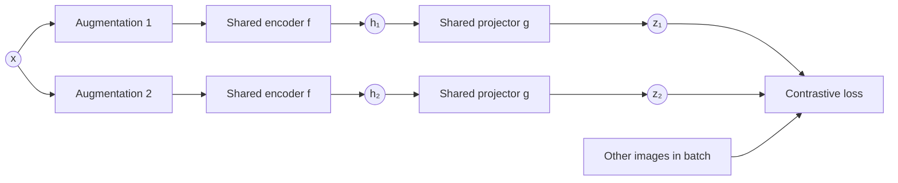
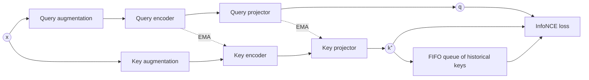

With VAEs the question we asked was *Can we compress the input into a latent representation that preserves enough information to reconstruct it*{: .rust}? With self supervised learning we remove the reconstruction objective and instead ask *Can we build a representation where different views of the same object are close together*{: .rust}? In other words we are moving from focussing on how much information should the latent space contain to focussing on the nature of that information. 

<!-- more -->

The central purpose of self-supervised representation learning is to train an encoder that extracts useful features from an image without requiring human-provided labels. The features, not the samples, are the product. 

The basic idea is to take one image and generate multiple transformed views of it through cropping, blurring, colour jitter, flipping or similar augmentations. The pixels may change considerably, but the underlying image identity does not. A useful encoder should therefore produce representations that are stable under these transformations: different views of the same image should map to similar representations, while independent images should remain distinguishable.

The challenge though is **representation collapse**{: .rust}. If the only objective were to make two views of the same image similar, the encoder could map every image to the same constant vector. Every pair would then match perfectly, but the representation would carry no information whatsoever.

Every SSL method is a different answer to *how do we avoid representation collapse*{: .rust}?

## SimCLR: identify the matching view

SimCLR, the first method that we study, is a **contrastive**{: .rust} method. It prevents collapse by explicitly contrasting each image against the other images in the minibatch.

!!! quote "Reference"

    Chen, Kornblith, Norouzi & Hinton (2020), [*A Simple Framework for Contrastive Learning of Visual Representations*](https://arxiv.org/abs/2002.05709), ICML.

For every original image $\mathbf{x}$, two random augmentations are drawn from a family $\mathcal{T}$:

$$
\mathbf{x}_1 = t_1(\mathbf{x}), \qquad \mathbf{x}_2 = t_2(\mathbf{x}), \qquad t_1, t_2 \sim \mathcal{T}
$$

Each view passes through the same two-stage neural network: an encoder $f$, usually a convolutional network, and a projection head $g$, usually a small multilayer perceptron.

The encoder produces $\mathbf{h} = f(\mathbf{x})$ and the projector produces $\mathbf{z} = g(\mathbf{h})$. The contrastive loss operates on $\mathbf{z}$, while $\mathbf{h}$ is retained as the representation for downstream applications.

For one anchor $\mathbf{z}_i$, the loss asks the model to identify its corresponding view $\mathbf{z}_j$ among all other views in the batch:

$$
\ell_{i,j} = -\log \frac{\exp \big( \text{sim}(\mathbf{z}_i, \mathbf{z}_j) / \tau \big)}{\sum_{k \neq i} \exp \big( \text{sim}(\mathbf{z}_i, \mathbf{z}_k) / \tau \big)}
$$

where $\text{sim}(\mathbf{u}, \mathbf{v}) = \mathbf{u}^\top \mathbf{v} / (\|\mathbf{u}\| \|\mathbf{v}\|)$ is the cosine similarity and $\tau$ is a temperature.

???+ info "InfoNCE"

    This objective is the **InfoNCE** loss, which arises from noise-contrastive
    estimation. It is a softmax cross-entropy over a set of candidates in which
    the "correct class" is the matching view. Minimising it maximises a lower
    bound on the mutual information between the two views.

This is effectively a classification problem: *which of the available representations is the other view of this image?* The positive pair should have high similarity, while representations of independent images act as negatives.

If every input collapsed to the same vector, all similarities would be equal, the model could not identify the positive pair, and it would do no better than random guessing. Negatives therefore make total collapse incompatible with a low loss.

### Why separate the representation and the projection?

The contrastive objective encourages the model to suppress information affected by the augmentations. If colour jitter is used, for example, colour-sensitive information becomes inconvenient for the contrastive task. Applying that pressure directly to $\mathbf{h}$ could cause the reusable representation to discard information that is still useful downstream.

The projection head provides a disposable training space:

$$
\mathbf{x} \longrightarrow \mathbf{h} \longrightarrow \mathbf{z}
$$

The loss is evaluated on $\mathbf{z}$, which allows the projector to specialise in augmentation invariance while giving the latent space $\mathbf{h}$ room to remain richer. This separation is not mathematically guaranteed, since gradients still flow through both the projector and the encoder. But the architecture creates an inductive bias that lets the projector absorb some of the strongest pressure imposed by the objective.

After training, the projector is discarded and the encoder output $\mathbf{h}$ is used.

## MoCo: a queue of historical negatives

SimCLR obtains its negatives from the current minibatch, so using more negatives normally requires a larger batch and more GPU memory. **Momentum Contrast (MoCo)** keeps the contrastive objective but changes how negatives are supplied. It introduces two separate paths: a *query* encoder and projector, and a *key* encoder and projector.

!!! quote "Reference"

    He, Fan, Wu, Xie & Girshick (2020), [*Momentum Contrast for Unsupervised Visual Representation Learning*](https://arxiv.org/abs/1911.05722), CVPR.

For each image, the query is compared with one positive key generated from another view of the same image, and with a large queue $\mathcal{Q}$ of keys generated from previous minibatches. The loss has the same broad form as SimCLR:

$$
\mathcal{L} = -\log \frac{\exp \big( \text{sim}(\mathbf{q}, \mathbf{k}^+) / \tau \big)}{\exp \big( \text{sim}(\mathbf{q}, \mathbf{k}^+) / \tau \big) + \sum_{\mathbf{k}^- \in \mathcal{Q}} \exp \big( \text{sim}(\mathbf{q}, \mathbf{k}^-) / \tau \big)}
$$

The query must identify its positive key among the queued negatives. The queue operates on a first-in, first-out basis: new keys are appended after each step and the oldest are dropped. This decouples the number of negatives from the minibatch size, so that

$$
\text{number of negatives} \approx \text{queue length}
$$

rather than being tied to the batch size.

The query-side parameters $\theta_q$ are optimised by backpropagation. The key-side parameters $\theta_k$ receive no gradients; they are updated as an exponential moving average of the query-side parameters:

$$
\theta_k \leftarrow m \, \theta_k + (1 - m) \, \theta_q, \qquad m \in [0, 1)
$$

The key encoder therefore changes slowly. This matters because the queue holds keys generated during earlier iterations, and a rapidly changing key encoder would make old and new keys mutually inconsistent. Momentum updating keeps the queued representations approximately compatible.

MoCo does not eliminate the need for negatives. It provides a memory-efficient way to maintain a great many of them. It can be considered an improved architecture but with the same mechanism as SimCLR.
