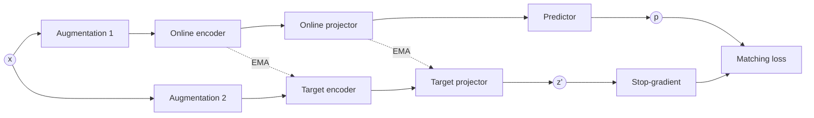
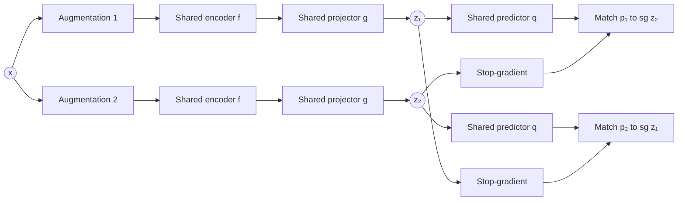

In [SimCLR / MoCo](2026-08-05-ssl-contrastive.md) and similar contrastive models, the model learns by pulling positive views together and pushing negative images apart. But why should learning useful representations require explicitly pushing different images apart?

<!-- more -->

Negatives introduce several problems:

- performance depends heavily on how many negatives are available
- large batches or queues are needed
- some negatives may actually depict semantically similar things
- the objective treats every other image as different, even when two images contain the same object class

For example, two different photographs of dogs are treated as negatives simply because they came from different source images. The contrastive loss pushes them apart, even though a useful semantic representation might ideally place them near one another.

So the non-contrastive question became:

> Can we learn simply by making two views of the same image agree, without comparing them to other images?

And as with contrastive learning, the challenge again is **representation collapse**{: .rust}.

## BYOL: learning without negatives

**Bootstrap Your Own Latent (BYOL)** asks whether useful representations can be learned without explicitly pushing independent images apart. It has two paths: an *online* path updated by gradient descent, and a *target* path updated through an exponential moving average.

!!! quote "Reference"

    Grill et al. (2020), [*Bootstrap Your Own Latent: A New Approach to Self-Supervised Learning*](https://arxiv.org/abs/2006.07733), NeurIPS.



The online branch contains three learned modules, encoder $\rightarrow$ projector $\rightarrow$ predictor, while the target branch contains only encoder $\rightarrow$ projector. The online prediction is trained to match the target projection:

$$
\mathcal{L}_{\text{BYOL}} = \left\| \frac{\mathbf{p}}{\|\mathbf{p}\|_2} - \text{sg} \left( \frac{\mathbf{z}'}{\|\mathbf{z}'\|_2} \right) \right\|_2^2
$$

Here $\text{sg}(\cdot)$ denotes **stop-gradient**: the target representation participates in the loss but is treated as a constant during backpropagation.

The same loss updates the online encoder, projector and predictor. The target encoder and projector are not updated by the loss; they slowly follow their online counterparts through an exponential moving average, exactly as in MoCo. The process can be read as *a rapidly learning online network predicting the representation produced by a slowly moving target network*{: .rust}.

Fresh augmentations are drawn at each training step, so over time the online network learns to predict representations that remain stable across many different views of each image.

BYOL's central surprise is that this works without negatives. Collapse is avoided through the asymmetry between the two branches. Stop-gradient prevents both sides from moving together within the same optimisation step, the predictor exists only on the online side, and the target network evolves slowly.

## SimSiam: stripping BYOL down to its essentials

**SimSiam** asks a natural follow-up question:

> Is the momentum target network actually necessary?

BYOL contains several candidate anti-collapse mechanisms:

- an online predictor
- stop-gradient on the target branch
- two separate parameter sets
- an EMA target network

SimSiam removes the momentum encoder and shows that useful representations can still be learned. Both views now pass through the **same shared encoder and projector**.

!!! quote "Reference"

    Chen & He (2021), [*Exploring Simple Siamese Representation Learning*](https://arxiv.org/abs/2011.10566), CVPR.



The two branches share parameters:

$$
\mathbf{x}_1 \rightarrow f \rightarrow \mathbf{h}_1 \rightarrow g \rightarrow \mathbf{z}_1, \qquad \mathbf{x}_2 \rightarrow f \rightarrow \mathbf{h}_2 \rightarrow g \rightarrow \mathbf{z}_2
$$

and a predictor is applied to each projection, $\mathbf{p}_1 = q(\mathbf{z}_1)$ and $\mathbf{p}_2 = q(\mathbf{z}_2)$.

Training is symmetric in value but asymmetric in gradient flow. In one direction the prediction from view 1 is matched to the stopped projection from view 2, and in the other direction the roles switch:

$$
\mathcal{L}_{1 \rightarrow 2} = D \big( \mathbf{p}_1, \text{sg}(\mathbf{z}_2) \big), \qquad \mathcal{L}_{2 \rightarrow 1} = D \big( \mathbf{p}_2, \text{sg}(\mathbf{z}_1) \big)
$$

The total loss averages the two:

$$
\mathcal{L} = \tfrac{1}{2} \big( \mathcal{L}_{1 \rightarrow 2} + \mathcal{L}_{2 \rightarrow 1} \big)
$$

where $D$ is typically the negative cosine similarity:

$$
D(\mathbf{p}, \mathbf{z}) = - \frac{\mathbf{p}}{\|\mathbf{p}\|_2} \cdot \frac{\mathbf{z}}{\|\mathbf{z}\|_2}
$$

### What stop-gradient changes

Consider the first direction, $\mathbf{p}_1 \rightarrow \text{sg}(\mathbf{z}_2)$. The value of $\mathbf{z}_2$ is used as the target, but no gradient flows through it, so within that loss term only the path producing $\mathbf{p}_1$ is changed. For the reverse term the roles switch. Each branch therefore alternates between two roles:

- predictor being optimised
- fixed target for the other branch

The network is shared, but the gradient paths are not symmetric within each loss term.

### How this differs from BYOL

BYOL maintains two parameter sets:

```text
Online network: updated by gradient descent
Target network: updated by EMA
```

SimSiam uses only one:

```text
Shared network: updated by gradient descent
Target output:  detached for each directional loss
```

There is therefore no momentum encoder, no EMA update, no queue and no negatives. The architecture is much simpler, yet it still avoids collapse.

### What does SimSiam reveal?

SimSiam demonstrates that a slowly moving teacher is not essential. The critical structure is the asymmetric prediction problem created by a predictor on the optimised side and a stop-gradient on the target side.

It is slightly too strong to say that stop-gradient by itself prevents collapse. In the SimSiam architecture, removing stop-gradient causes collapse, and the predictor is also an important part of the successful configuration. The safer conclusion is that predictor asymmetry and stop-gradient are together *sufficient* to learn useful representations without negatives or a momentum target.

The theoretical explanation remains subtle. A collapsed representation is still mathematically compatible with the matching objective. It is the optimisation dynamics created by the stop-gradient and the predictor that steer training away from that solution. The resulting progression is:

$$
\begin{aligned}
\text{BYOL} &= \text{predictor} + \text{stop-gradient} + \text{EMA target} \\
\text{SimSiam} &= \text{predictor} + \text{stop-gradient}
\end{aligned}
$$

## Four answers to the same problem

These methods are best understood as different answers to one question: *how can two views of the same image be made similar without mapping every image to the same representation*{: .rust}?

| Method | Negatives | Anti-collapse mechanism |
| --- | --- | --- |
| SimCLR | in-batch | contrastive loss over other images |
| MoCo | FIFO queue | contrastive loss plus momentum key encoder |
| BYOL | none | predictor, stop-gradient, EMA target |
| SimSiam | none | predictor, stop-gradient |

In every case the final product is the encoder representation $\mathbf{h}$. The projection heads, predictors, queues and momentum networks are training mechanisms used to shape that representation, and they are discarded once self-supervised training is complete.

???+ info "Evaluating a self-supervised encoder"

    The standard protocol is the **linear probe**: freeze the encoder, train a
    single linear classifier on $\mathbf{h}$ using labelled data, and report its
    accuracy. A good self-supervised representation makes the classes linearly
    separable, so the quality of $f$ can be measured without fine-tuning it.
