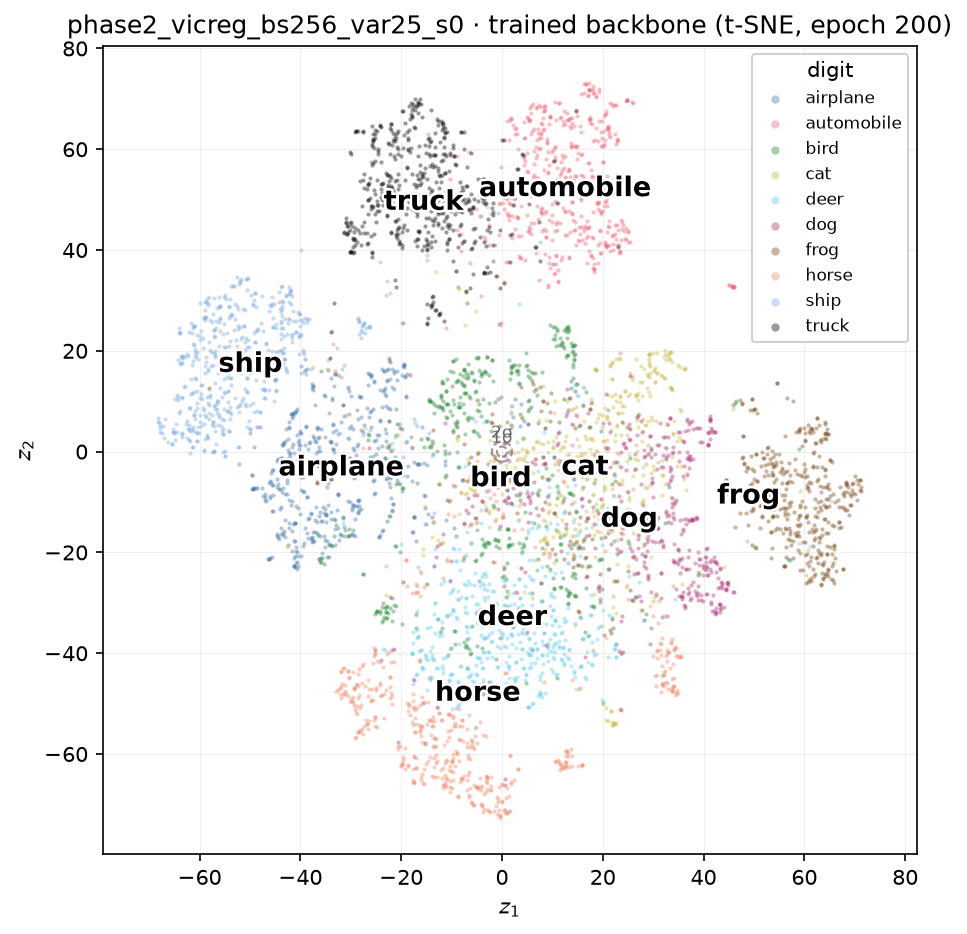
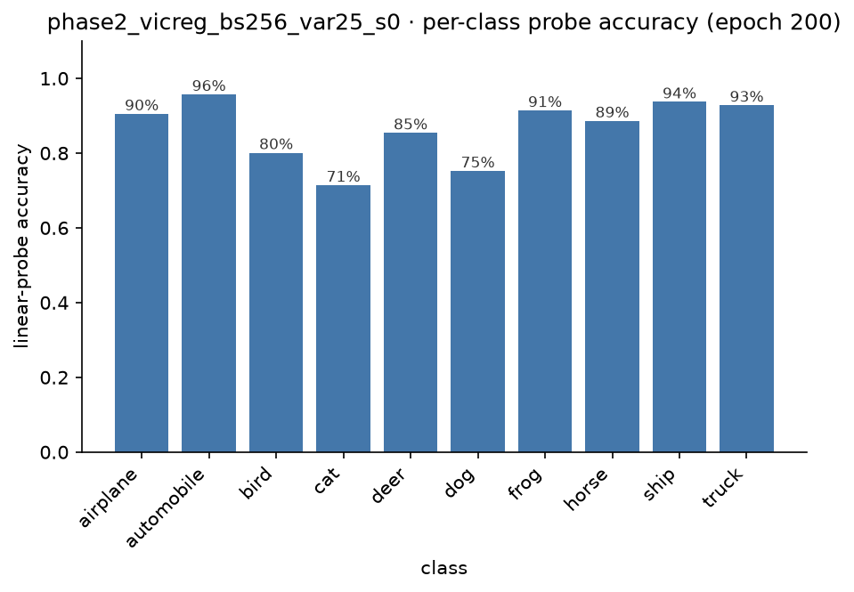
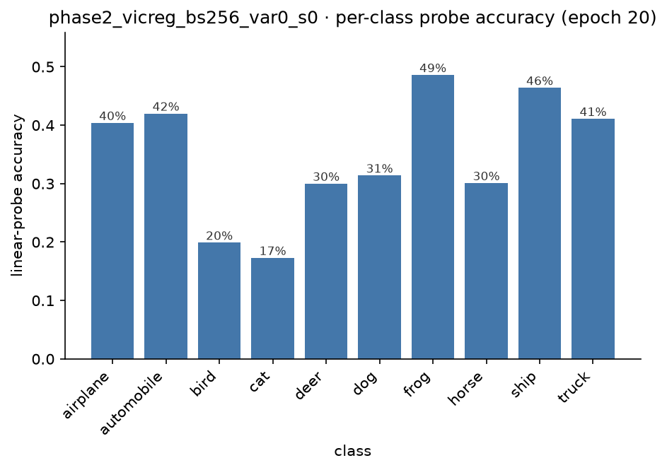
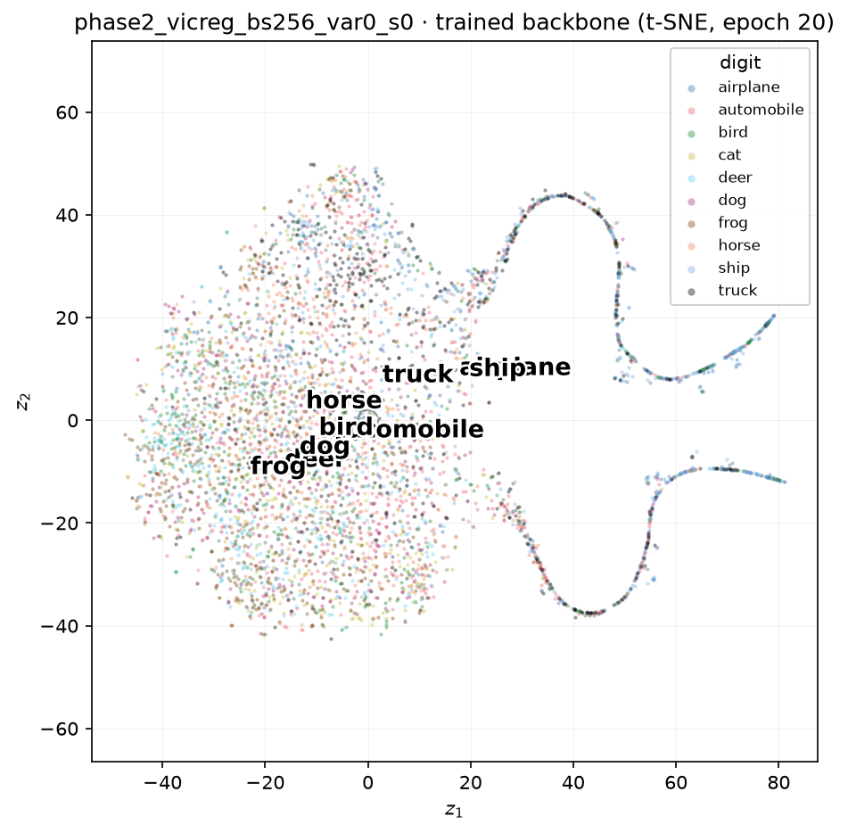

[SimCLR](2026-08-06-inside-simclr.md) prevents collapse by actively pushing away every other image in the batch. [SimSiam](2026-08-17-inside-simsiam.md) removes the negatives and survives on architectural asymmetry alone, with a predictor on one branch and a stop-gradient on the other. VICReg removes the architecture too and focusses inwards onto the representation. Both branches here are perfectly symmetric. No predictor, no stop-gradient, no negatives of any kind. Collapse is prevented by punishing any latent dimension whose variance across the batch drops too low. If the first two methods each found an implicit way to avoid collapse, this one explicitly writes the constraint down. Does saying it out loud work better, or differently, than relying on negatives or asymmetry?

<!-- more -->

## The setup

We use the same primary encoder as the other two: the **CIFAR-adapted ResNet-18 with a 512-D output**{: .rust}, same augmentation pipeline, same CIFAR-10 data, same batch size (256) and optimiser (SGD, cosine schedule with warm-up), deliberately matched so the only thing that differs across all three experiments is the anti-collapse mechanism itself.

On top sits a wide **expander**{: .rust}, the opposite shape from SimCLR's compressing projector or SimSiam's bottleneck predictor: `Linear(512,2048) → BN → ReLU → Linear(2048,2048) → BN → ReLU → Linear(2048,2048)`, deliberately ending on a plain, unnormalised `Linear` layer.

???+ info "Why the last layer has no batch norm"

    If the final layer were normalised the way SimSiam's projector deliberately is, that normalisation would satisfy the variance term structurally regardless of what the loss is doing, making the variance weight vacuous no matter what it's set to. The loss needs to act on genuinely unconstrained outputs for the constraint it enforces to mean anything at all.

The loss has three independent terms, computed on each branch and averaged:

$$
\mathcal{L} = \lambda \cdot \operatorname{MSE}(z_1, z_2) \;+\; \mu \cdot \tfrac12\big[h(z_1) + h(z_2)\big] \;+\; \nu \cdot \tfrac12\big[c(z_1) + c(z_2)\big]
$$

$$
h(z) = \frac{1}{D}\sum_{j=1}^{D} \max\!\big(0,\ \gamma - \sqrt{\operatorname{Var}(z_j) + \epsilon}\,\big), \qquad
c(z) = \frac{1}{D}\sum_{i \neq j} C_{ij}^{\,2},\quad C = \frac{1}{N-1}\tilde z^{\top}\tilde z
$$

with the paper's own weights kept unchanged: $\lambda = \mu = 25$, $\nu = 1$, $\gamma = 1$. **Invariance**{: .rust} is plain MSE with no normalisation anywhere. Unlike SimCLR/SimSiam's cosine-based losses, this term alone would happily reward shrinking both views toward a single point, since a smaller gap between them reduces MSE regardless of overall scale. **Variance**{: .rust} is the actual anti-collapse mechanism. Hinge every dimension's per-batch standard deviation against a floor $\gamma$, independently on each branch. A dimension whose spread drops below the floor is directly penalised, full stop; nothing else in this loss cares whether a magnitude collapse happens, so this term alone is carrying that entire load. **Covariance**{: .rust} discourages different dimensions from carrying redundant information, penalising the off-diagonal entries of the batch covariance matrix.

???+ warning "A different init check, on purpose"

    NT-Xent's random-init value was $\log(2N-1)$, a large, predictable number. SimSiam's bounded loss concentrated near 0. VICReg's MSE-based invariance term has no comparable universal target. Its value at init depends on the untrained network's raw, unconstrained output scale, which isn't pinned to anything. So the init check here doesn't assert a number; it just confirms all three terms come back finite and non-negative before training starts. Not every method offers a clean invariant to check against, and pretending otherwise would be manufacturing a number rather than reporting one.

## Training: two curves that don't do what you'd guess

Watching `inv`, `var`, and `cov` separately over 200 epochs turns up two things that aren't the obvious first guess.

`var` declines the entire run, from 0.685 at epoch 1 down to 0.339 at epoch 200, but it never gets close to the floor of zero the hinge is aiming for. Even at epoch 200, the weighted variance term ($\mu \times 0.339 \approx 8.5$) is still the single largest contributor to the total loss (13.7), ahead of both invariance and covariance combined. The constraint is never fully satisfied; the optimiser settles into an equilibrium where it's still being actively paid for, all the way to the end.

`cov`, meanwhile, *rises* across the run, from 0.819 to 2.952, despite being the term whose entire job is to push it down. The resolution is that raw covariance isn't the same thing as correlation: $\operatorname{Cov}(z_i, z_j) = \rho_{ij}\,\sigma_i\sigma_j$. As the variance term pushes every dimension's standard deviation up toward its floor, the whole representation's scale grows, and a shrinking correlation coefficient can still produce a *larger* raw covariance number if the per-dimension scale is growing faster than the correlation is falling. The scale-invariant read is the one to trust here, exactly the lesson [the VAE's active-units metric](2026-08-01-inside-a-vae.md) and [SimSiam's effective-rank fix](2026-08-17-inside-simsiam.md) both already taught: **participation ratio climbs cleanly to 86.3/512 across the same run**{: .rust}, confirming the representation really is becoming more decorrelated relative to its own scale, even while the raw number moves the "wrong" way.

## Does it actually work?

| | random floor | SimCLR | SimSiam | VICReg |
| --- | --- | --- | --- | --- |
| linear probe | 37.9% | 88.1% | 86.6% | **86.5%** |
| k-NN | 28.6% | 86.6% | 85.0% | **86.0%** |
| effective rank | n/a | n/a | 31.1/512 | **86.3/512** |

A third mechanism, sharing no design principle with the other two, lands within a point and a half of both on accuracy. The pattern holds a third time: negatives, architectural asymmetry, and an explicit loss constraint all arrive at essentially the same representation quality.

The rank number is the interesting new one. VICReg's representation spreads its variance across nearly **three times as many effective dimensions**{: .rust} as SimSiam's, for statistically indistinguishable classification accuracy. This as a matter of fact, falls directly out of what the loss optimises for. Participation ratio measures two things: how evenly variance is spread across dimensions, and how decorrelated those dimensions are from each other. VICReg's variance and covariance terms are a direct, explicit pressure toward precisely that. SimCLR's negatives act on *images*, not dimensions; SimSiam's asymmetry has no notion of "dimension" at all. Neither has any mechanism that cares how the 512 dimensions individually behave, only that the whole vector avoids collapsing as one. VICReg is the only one of the three whose objective is, in effect, partially the same computation as the diagnostic. That the extra spread buys no extra accuracy is itself quite noteworthy. Roughly 30 well-organised dimensions are already enough to solve this classification task, and the other ~56 VICReg finds room for are decorrelated but functionally redundant for it.

## The per-class picture

| class | SimCLR | SimSiam | VICReg |
| --- | --- | --- | --- |
| automobile | 96.8% | 97.0% | 95.7% |
| ship | 93.5% | 94.6% | 93.7% |
| truck | 93.7% | 94.0% | 92.8% |
| frog | 92.5% | 91.6% | 91.4% |
| airplane | 92.5% | 90.6% | 90.5% |
| horse | 89.8% | 89.4% | 88.6% |
| deer | 86.2% | 86.0% | 85.4% |
| bird | 80.9% | 77.0% | 80.1% |
| dog | 80.0% | 75.2% | 75.2% |
| cat | 75.4% | 70.7% | 71.4% |

Three findings, and none of them are new exactly, they're the same two findings from the SimCLR/SimSiam comparison, confirmed a third time by a mechanism that shares nothing with either.

1. **The ranking rhymes.** Vehicles and frog/airplane above 90%, horse/deer in the mid-80s, bird/dog/cat at the bottom: the same clustering, three unrelated objectives running.
2. **The vehicle/animal boundary holds without exception.** Every class's top confusion (`airplane↔ship`, `automobile↔truck`, `bird↔deer`, `cat↔dog`, `deer↔bird`, `dog↔cat`, `frog→cat`, `horse→deer`) stays inside its own broad category. Zero cross-superclass errors, for the third time running.
3. **Cat and dog are the hardest pair a third time**, and the `dog→cat` figure (15.4%) lands almost exactly on SimSiam's (15.3%).

## Breaking it: zero out the variance term

SimSiam's break-it experiment needed a structural change (removing the stop-gradient, or swapping the predictor for the identity) because its anti-collapse mechanism *is* a piece of architecture. VICReg's equivalent needs no special flag: the variance term already has a continuous weight, so `--var-weight 0.0` on the ordinary training script *is* the ablation.

| epoch | loss | inv | var | cov |
| --- | --- | --- | --- | --- |
| 1 | 0.507 | 0.0159 | 0.951 | 0.109 |
| 2 | 0.0013 | 5.3e-5 | 0.989 | 6.2e-7 |
| 4 | 0.0012 | 4.8e-5 | 0.989 | 3.7e-6 |
| 8 | 1.9e-4 | 7.6e-6 | 0.990 | 2.3e-7 |
| 16 | 8.1e-7 | 3.2e-8 | 0.990 | 4.4e-14 |
| 20 | 5.7e-7 | 2.3e-8 | 0.990 | 2.1e-14 |

This is a *different kind* of failure than SimSiam's. SimSiam's broken loss converged toward its bounded floor of $-1$, a finite number that could plausibly look like real convergence. Here, with the variance floor gone, mapping every image to the same output vector makes `inv` trivially zero, and with zero variance across the batch there's nothing left to covary, so `cov` collapses to zero too. **Both surviving terms have their literal global minimum exactly at total collapse**{: .rust}, so this isn't a loss that merely looks converged: it mathematically is the correct answer to a now-degenerate objective, and it gets there inside two epochs.

???+ success "The variance term's own floor, confirmed to four decimal places"

    With `var_weight=0`, the variance term is excluded from the gradient entirely, so it's a pure bystander here, free to just report what happened. It converges to **0.98999...**, and that number isn't arbitrary. Total collapse drives every dimension's variance to exactly zero, so the hinge's own numerical floor sets its value at $\gamma - \sqrt{\epsilon} = 1 - \sqrt{10^{-4}} = 0.99$ exactly. The math and the observed number agree to four decimal places: direct, quantitative confirmation that the collapse is total, not partial.

| epoch | probe | k-NN | effective rank |
| --- | --- | --- | --- |
| 1 | 37.6% | 32.8% | 1.33 |
| 2 | 36.6% | 32.2% | 1.14 |
| 4 | 36.3% | 30.7% | 1.26 |
| 8 | 36.5% | 31.6% | 1.68 |
| 16 | 35.0% | 30.1% | 1.75 |
| 20 | 34.7% | 30.4% | 1.75 |

Rank pinned near 1 for the entire run, probe sitting below the random floor (37.9%) throughout, kNN hovering just above its own floor (28.6%), a clearly, thoroughly collapsed representation, in the same territory as both SimSiam ablations (final ranks 1.03 and 1.08).

But it fails *quietly*, unlike SimSiam whose broken runs kept producing real, if harmful, gradients for the full 20 epochs, since its loss stays bounded but non-zero, training kept actively eroding the representation the whole way (its stop-gradient ablation's probe fell from 40.5% at epoch 1 to 29.4% by epoch 20). Here, once `inv` and `cov` hit essentially zero around epoch 2, there is no more loss signal left to act on. `participation_ratio` barely moves after that (1.14 → 1.26 → 1.68 → 1.75), despite the learning-rate schedule still ramping toward its peak. The representation free-falls to the trivial solution almost immediately, then the network is effectively frozen there rather than being dragged progressively further down.

That difference shows up sharply in the per-class breakdown:

| class | accuracy | most confused with |
| --- | --- | --- |
| frog | 48.6% | deer (13.1%) |
| ship | 46.4% | airplane (13.4%) |
| automobile | 42.0% | truck (15.7%) |
| truck | 41.1% | automobile (16.1%) |
| airplane | 40.4% | ship (20.2%) |
| dog | 31.4% | frog (15.7%) |
| horse | 30.1% | dog (13.8%) |
| deer | 30.0% | frog (24.7%) |
| bird | 19.9% | deer (19.0%) |
| cat | 17.3% | frog (19.8%) |

Every single top confusion here still stays inside its own broad category, vehicles confused only with vehicles, animals only with animals: the same boundary the three *healthy* runs preserved without exception. That is the opposite of what happened to SimSiam: both of its ablations broke that boundary (`horse→truck` appeared in both, `bird→airplane` in one), an animal-for-vehicle mistake that never occurred in any healthy run of any method. VICReg's collapsed representation, despite being just as numerically dead by every aggregate metric, never makes that particular kind of mistake.

The likely explanation is the same "quiet death" mechanism above. SimSiam's ablations kept a live, non-zero loss actively reshaping the representation for the entire 20 epochs, which is plausibly what it took to corrupt even the coarse structure. VICReg's ablation collapses to a literal near-zero loss within two epochs and then stops moving in any meaningful sense, closer to a network that free-fell partway and was caught than one that was actively driven somewhere worse for twenty epochs straight.
## What the experiment teaches

Three anti-collapse mechanisms that share no design principle all land within a point and a half of each other on accuracy, all agree on which classes are easy and which are hard, and all preserve the exact same vehicle/animal boundary without exception. That triple agreement is strong evidence the structure being found is a fact about CIFAR-10, not an artefact of any one method.

But the three mechanisms disagree completely on *how* they fail once broken. SimCLR structurally cannot collapse at all. SimSiam's collapse is architecturally driven and stays live for as long as training continues, actively eroding the representation until even the coarse category boundary gives way. VICReg's collapse is near-instant and then goes numerically silent, a representation that is dead by every quantitative measure yet, oddly, still respects the one piece of structure every healthy run agreed on. Collapse, it turns out, is not a single failure mode. It's as varied as the mechanisms built to prevent it.

**I-JEPA**{: .rust}, the predictive family, is next, and it gets to answer a different question entirely: what happens when the pressure to avoid collapse comes not from negatives, asymmetry, or an explicit constraint, but from predicting representations directly.