Ask a language model any question today and you can expect an answer. Ask it how sure it is and you promptly get a confidence score. Both seem convincing and LLMs seem to know what they are doing. But does that number mean anything? **Can a model tell the answers it got right from the ones it got wrong?**{: .rust} Accuracy doesn't tell you that. A model that is right 80% of the time and exudes "95% confidence" every time is a usable answerer but a poor judge of itself. Here we audit that second skill across nine models, 680 questions and seven ways of asking for confidence, and find that what a model *says* about its confidence and what its *behaviour* reveals are two quite different things.

<!-- more -->

Most language models have become adept at answering questions convincingly. With reasoning models going through several stages and iterations, the accuracy of their answers have increased. But models, both the vanilla ones and the more sophisticated reasoning ones, hallucinate. 

## Hallucination as a confidence problem

In [Why Language Models Hallucinate](https://arxiv.org/abs/2509.04664), Kalai et al. explain a **hallucination**{: .rust} as a plausible but false statement made by a model. Hallucinations according to them, are not a mysterious glitch but a statistical consequence of how models are built. Pre-training makes some errors unavoidable, especially on **singleton facts**{: .rust} that appear rarely in the training data, but which the model is still forced to accommodate due to binary classification pressures. Post-training then optimises models for **test-taking benchmarks**{: .rust} that score a right answer as 1 and both a wrong answer and an "I don't know" as 0. Under that grading, guessing always beats admitting uncertainty, so a model learns to answer confidently whether or not it knows.

That makes hallucination as much about confidence as about accuracy. A wrong answer flagged as uncertain is one a user, or a system built around the model, can check. The same wrong answer delivered with full confidence is the one that does the damage. But what about reasoning models?

Thinking before answering raises accuracy, sometimes dramatically, but it does not follow that a model knows better when it is *still* wrong. In [Reasoning about Uncertainty: Do Reasoning Models Know When They Don't Know?](https://arxiv.org/abs/2506.18183) Mei et al. found that reasoning models typically state 85% confidence or more even on answers they get wrong, and that on those wrong answers they grow **more overconfident the longer they reason**{: .rust}. Zeng et al. in [Thinking Out Loud: Do Reasoning Models Know When They're Right?](https://arxiv.org/abs/2504.06564) found that reasoning training improves calibration on reasoning-heavy tasks but much less consistently on factual questions, where open reasoning models say "I don't know" far less often than ordinary instruction-tuned ones.

Pre-trained base models are naturally well-calibrated because they are optimised using cross-entropy loss. But reasoning models undergo post-training with methods like RLHF and instruction tuning which are often incentivised for confidence by their human rewarders, thereby losing their base calibration. Another intuition: a chain of thought builds an argument for its answer, and the argument persuades the model that wrote it as much as the reader. That is what leads to autoregressive stubbornness where a mistake made in an earlier stage of reasoning is justified and compounded further down the chain. The audit includes one model with thinking on and off, on the same weights, to test this directly.

## What we build on

We base this study on other works that try to tackle the confidence measurement problem.

- [ConfidenceBench](https://arxiv.org/abs/2607.20526) (ffrench-Constant et al., 2026) extracts verbal confidence from 15 frontier models on 200 multiple-choice questions in four categories, one of them unknowable, scored with Brier. It found that the most accurate model is not the best calibrated, but it reports no results per category. Grading self-knowledge separately for each kind of question, with difficulty held fixed, is what this audit adds.
- [ForecastBench](https://arxiv.org/abs/2409.19839) (Karger et al., 2024). Questions about events that had not happened when the models were trained, so the answers cannot have been memorised. The audit's forecasting questions come from its question sets.

The other confidence signals in the audit, agreement across a model's own samples and the probability it puts on its answer tokens, are standard measures from the wider calibration literature.

The audit is built from the test side. Rather than one overall calibration score, which can hide a model that is overconfident on obscure facts and underconfident on arithmetic, we sort questions by **what it takes to answer them**{: .rust}, give each kind a difficulty dial, and grade self-knowledge separately on each.

## The questions

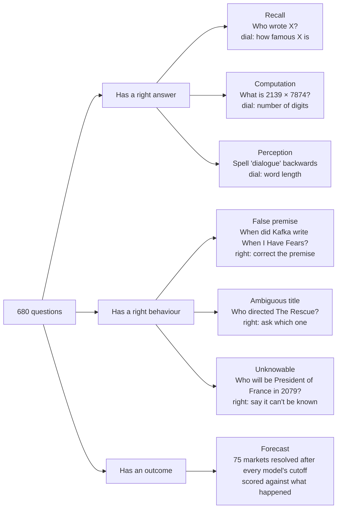

The three answerable categories are each 150 questions, 30 at each of five difficulty levels, and they are chosen because they fail for different reasons. **Recall**{: .rust} fails when a fact is rare in the training data. **Computation**{: .rust} fails when errors pile up digit by digit during generation. **Perception**{: .rust} fails because a model sees tokens, not letters, so counting the n's in "recommendations" is a blind spot it may not know it has. The dials do their job: accuracy falls level by level for every model, from near 100% to near 0.

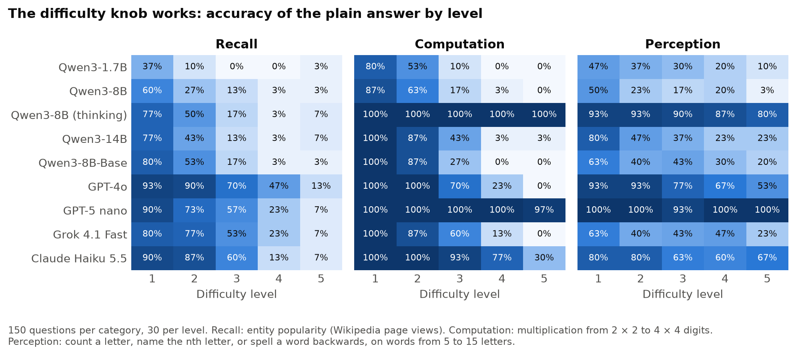

## Seven ways of asking "how sure are you?"

Every question goes to every model in sixteen separate calls, each a fresh conversation, so the methods can be compared question by question.

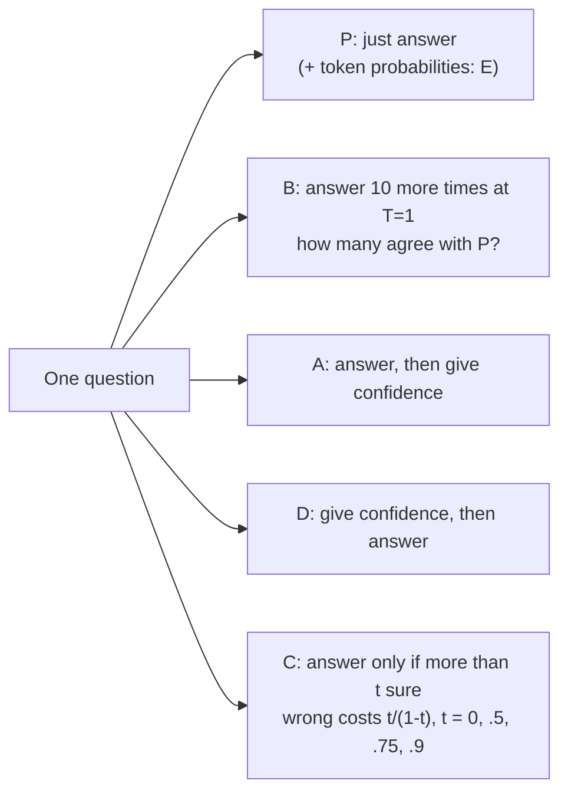

Two of these are things the model *says* (A after answering, D before it, a feeling-of-knowing). Two are things it *does*: whether its own samples agree (B) and how much probability it puts on its answer tokens (E, where the provider exposes them). The last (C) states the stakes in the prompt, using the scoring rule Kalai et al. proposed in *Why Language Models Hallucinate*: under it, answering only pays when you are more than t sure, so a model that knows its own confidence should abstain more as t rises.

The nine configurations were picked to exercise the methods rather than to rank vendors:

| Model                 | Where            | What it tests                                    |
| --------------------- | ---------------- | ------------------------------------------------ |
| Qwen3-1.7B, 8B, 14B   | local RTX 4090   | size within one family, every method including E |
| Qwen3-8B, thinking on | local RTX 4090   | reasoning on vs off, same weights                |
| Qwen3-8B-Base         | local RTX 4090   | base vs instruct (few-shot; P, B, E only)        |
| GPT-4o, Grok 4.1 Fast | Azure AI Foundry | other vendors, with token probabilities          |
| GPT-5 nano            | Azure AI Foundry | a closed reasoning model, no token probabilities |
| Claude Haiku 5.5      | Anthropic API    | no temperature control, no token probabilities   |

The whole thing came to about 100,000 model calls and **under $7**{: .rust}: about $5.80 on Foundry, $0.30 for Claude, and the 4090's electricity.

## Grading without fooling ourselves

Arithmetic and spelling can be marked by code. "Who wrote X?" mostly can too, by matching against known aliases. But "did this response correct the false premise?" needs a judge, and the first judge we tried (Qwen3-14B) agreed with a hand-labelled set only 77 times out of 120. It stumbled on bare refusals like "Unknown" and on denials that happened to contain a year.

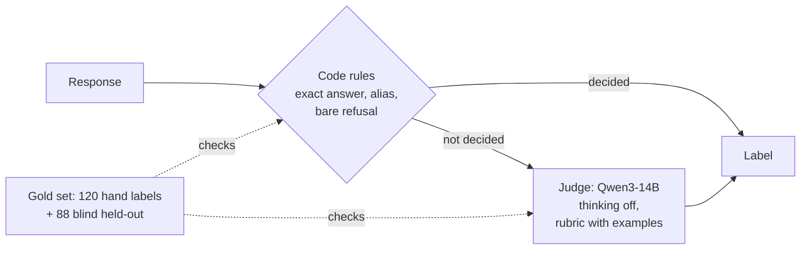

So we built the grader the other way round: code rules for everything they can decide, the judge only for the rest, and both checked against hand labels. Claude drafted 120 labels, which were reviewed by hand, and the rubrics were rewritten until rules plus judge agreed on 114. Then came the honest test: two **blind held-out sets**{: .rust}, labelled with the judge's answer hidden.

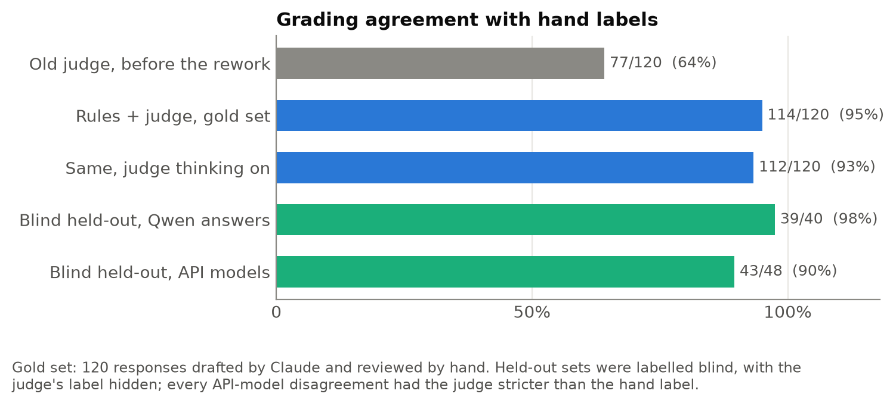

???+ info "Thinking off was the better judge"
    Letting the judge reason before labelling scored 112/120 against 114 with thinking off. Among its new mistakes: it marked "Trent Reznor and Atticus Ross" wrong as the composers of *The Social Network*, a score the two of them wrote. On the API models' held-out set, all five disagreements had the judge *stricter* than the hand label, so if anything the scores below understate the models.

## Two kinds of self-knowledge

Before getting into the results, there is one distinction that helps us on how to read them. The standard measure of whether confidence separates right from wrong is [AUROC](https://en.wikipedia.org/wiki/Receiver_operating_characteristic), the chance that a randomly chosen right answer carries more confidence than a randomly chosen wrong one (0.5 is a coin toss, 1.0 is perfect). But a model can score well on it by knowing only that *long multiplications are risky and short ones are safe*. That's real self-knowledge, but coarse. The finer skill is knowing which of several equally hard answers is the wrong one.

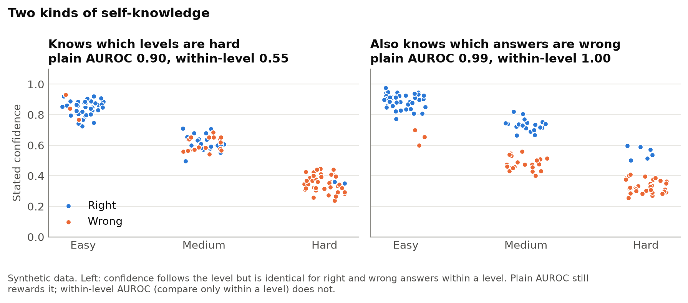

**Within-level AUROC**{: .rust} keeps only the second kind, by comparing right and wrong answers only inside the same difficulty level. 

???+ info "Parallels with human metacognition research"
    The corresponding tool from human metacognition research, **meta-d′**{: .rust}, (see [A signal detection theoretic approach for estimating metacognitive sensitivity from confidence ratings](https://www.sciencedirect.com/science/article/pii/S1053810011002303),) needs a two-choice task to measure against; open-ended answers don't have one, so we control for difficulty this way instead, plus a regression with a separate baseline for every model × category × level.

## What they say vs what they do

Here is the main result in one picture: within-level AUROC for every model, category and method.

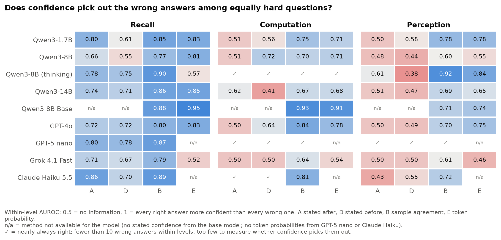

Read it by column. The two "said" columns (A and D) are informative on recall and drift to 0.5, no information at all, on computation and perception. The two "done" columns (B and E) stay well above 0.5 almost everywhere. Grok's token probabilities are the exception, saturated near certainty on everything.

The same split shows up in calibration. Take one set of weights, Qwen3-8B, and read its confidence three ways:

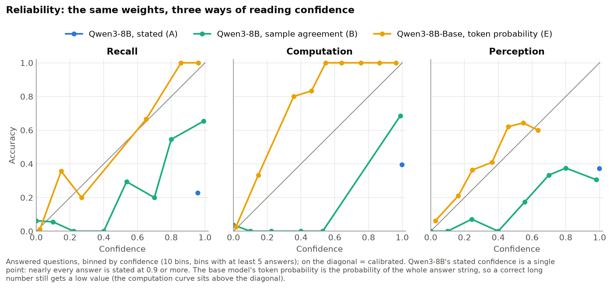

Its stated confidence is a single dot: **nearly every answer is stated at 0.9 or more**{: .rust}, whether the accuracy behind it is 20% or 40%. Its sample agreement is a proper curve, if an overconfident one. And the base model, before any instruction tuning, sits close to the diagonal on recall, which is exactly what Kalai et al. predict: pre-training produces calibrated probabilities, and post-training erodes them.

The practical upshot is a simple rule. When a model says it is sure but its own samples scatter, believe the samples:

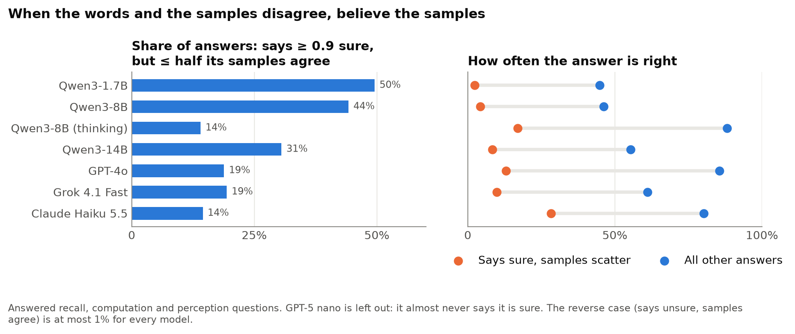

??? example "What that looks like"
    Grok 4.1 Fast, asked **What is 2139 × 7874?** (16,842,486) three separate times, answered 16,834,486, then 16,843,086, then 16,845,186, each time with **confidence 1.0**. Only 2 of its 10 samples agreed with its first answer. GPT-4o, asked who wrote the screenplay for the Kannada film *Kotigobba*, named K. S. Ravikumar at confidence 0.9; 3 of 10 samples agreed, and the answer was wrong.

## The category matters, not just the difficulty

Is perception just harder? The regression says no. With a separate baseline for every model × category × level cell, the slope tells how much more likely a model's most confident answer is to be right than its least confident one, at the same difficulty:

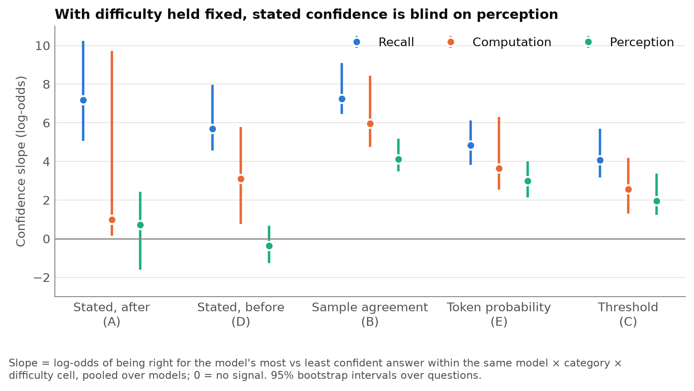

Perception sits below recall for **every**{: .rust} method, and for the two stated methods its slope is indistinguishable from zero. Plotting every cell at its own accuracy shows the same thing without the model: at matched accuracy, stated confidence works on recall and is flat on perception, while sample agreement keeps working on both.

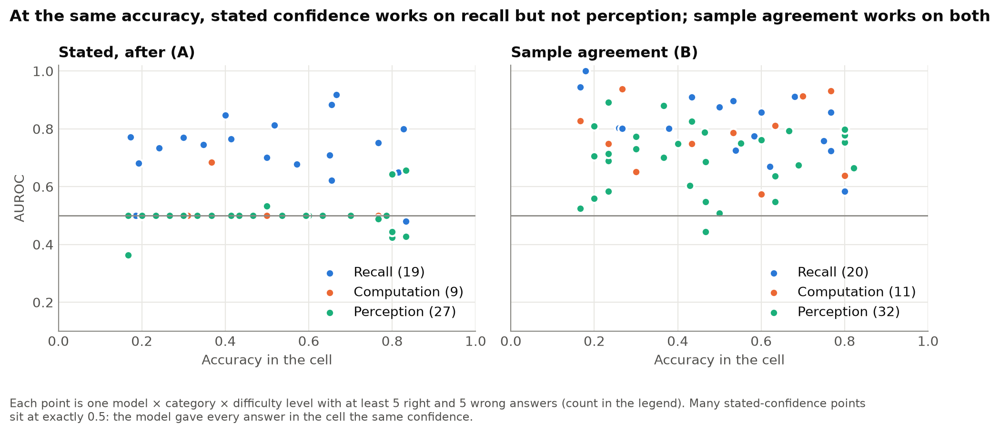

That fits the mechanism. A model has some internal sense of how familiar a fact is; it has no view at all of the letters inside a token, so it cannot know that it has miscounted them.

## The hard-easy effect, but only in the words

Psychologists have long seen people overconfident on hard questions and underconfident on easy ones (see Lichtenstein, S. & Fischhoff, B. [Do those who know more also know more about how much they know?](https://www.sciencedirect.com/science/article/pii/0030507377900010). The models show half of it:

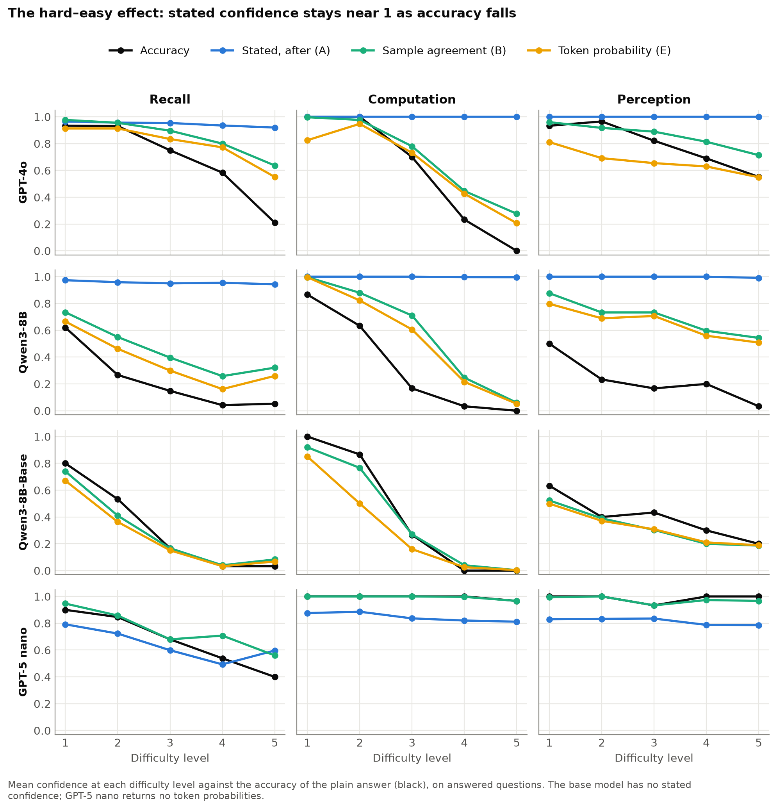

GPT-4o's stated confidence (blue) sits at 1.0 on the hardest multiplications, where it is right 0% of the time. It looks calibrated on easy questions only because it happens to be right there; there is no underconfidence on the easy end, just a line pinned at the top. Its sample agreement (green) and token probability (yellow) fall with accuracy. The base model's lines follow accuracy almost exactly. GPT-5 nano is the one model that errs the other way: it is nearly always right on computation and perception, and still says about 0.8.

## Thinking on: more right, not more aware

Qwen3-8B with thinking on and off is the same weights answering the same questions, so the pair isolates what reasoning does. It transforms accuracy where the answer can be worked out: computation goes from 34% right to 100%, perception from 23% to 89%, and the model corrects 68% of false premises instead of 15%. On facts it helps far less, 34% right against 25%, because no amount of reasoning recovers a fact the model doesn't hold.

Those facts are where the overconfidence shows. After thinking, the probability the model puts on its final answer averages **0.95 on recall questions it gets right only a third of the time**{: .rust}; without thinking, the same measure averaged 0.39. The reasoning settles on an answer and the answer is then written out with near certainty, so the token probability loses most of its signal: within-level AUROC 0.57, against 0.81 without thinking. Stated confidence after thinking is also high, 0.88 on average at 32% right, although it separates right from wrong a little better than without thinking (0.78 against 0.66), and so does sample agreement (0.90 against 0.77). On computation thinking leaves no errors to measure, so the test of its self-knowledge rests on facts and spelling.

## Before or after answering?

Is confidence more honest before the model commits to an answer, a feeling of knowing, than after, when it has an answer to defend? On the same questions, within levels:

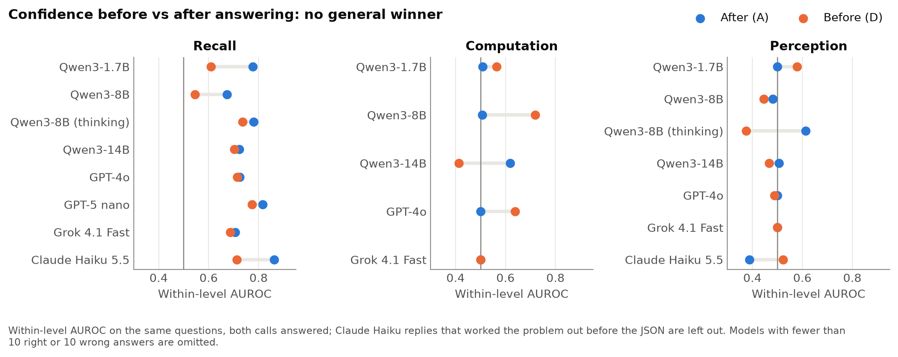

There is **no general winner**{: .rust}. Asking first helps Qwen3-8B and GPT-4o on computation, hurts Qwen3-14B, and on recall asking after is as good or better. An early version of this analysis said "before beats after on computation"; that turned out to be mostly the coarse kind of self-knowledge, knowing which levels are hard, and it largely vanished within levels.

???+ warning "Claude Haiku shows its work"
    Asked for an answer plus a confidence in JSON, Claude Haiku 5.5 often ignored "Reply with only a JSON object" and worked the problem out first: `777 × 933 = 777×900 + 777×33 = 699300 + 25641 = 724941`, then the JSON. That lifts its accuracy and means its "before" confidence on arithmetic isn't really before. Those replies are flagged and left out of this comparison.

## Questions without a proper answer

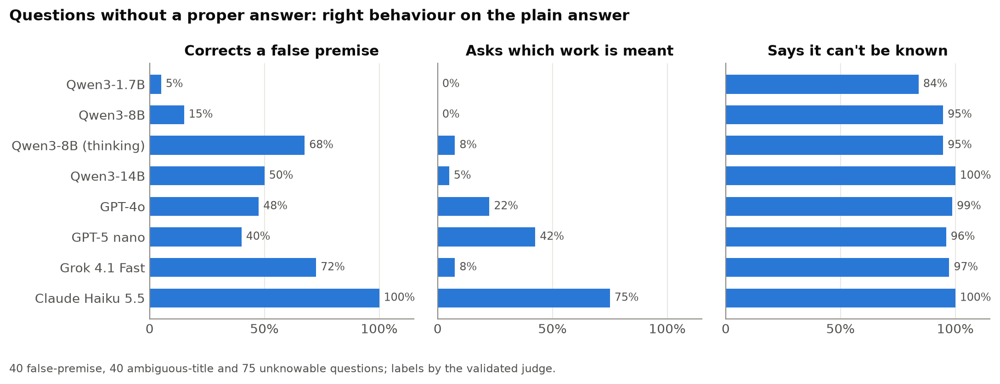

Unknowable questions are easy for everyone. False premises and ambiguous titles are where the models separate, and Claude Haiku is in a class of its own: it corrects every false premise and asks which work is meant on three ambiguous titles in four ("Ambiguous: several films are titled 'The Rescue.'"). GPT-4o names the directors of one of them and moves on.

Confidence itself turns slippery here. GPT-4o answered "Cannot be determined" to *Who will be President of France on 1 January 2079?* with confidence **1.0** after answering, and **0.0** when asked before. Both are reasonable: after, it rates the response ("I'm sure this can't be known"); before, it rates its ability to answer. The models don't agree on which reading to use:

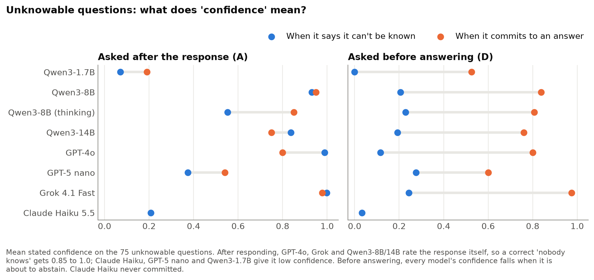

## Telling the model the stakes

The threshold prompt is the cleanest test of whether a model can *use* its confidence. If a wrong answer costs 9 points at t = 0.9 and only 1 at t = 0.5, a model that knows when it is unsure should abstain far more at 0.9.

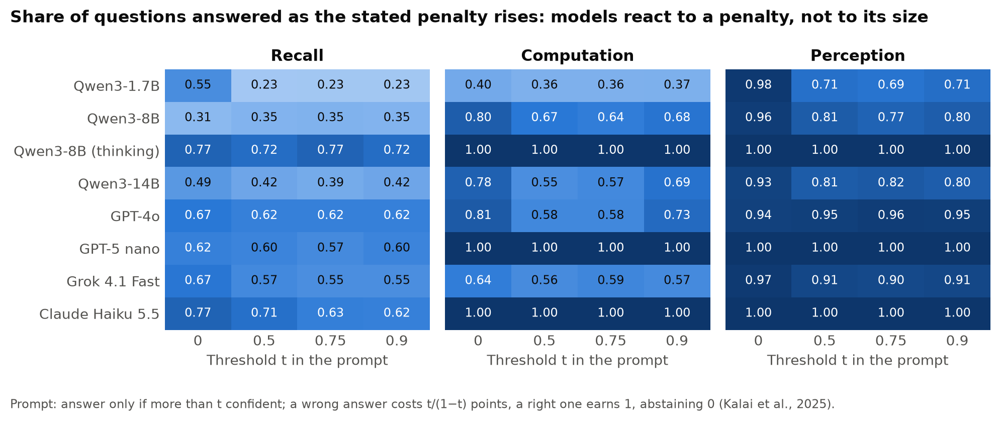

They don't. Answer rates drop once, when a penalty appears at all, and then stay flat. **Models react to the existence of a penalty, not to its size.**{: .rust} GPT-5 nano and Claude Haiku answer every arithmetic question at every threshold.

Haiku's response to the stakes is the most interesting: instead of abstaining, it shows its working, and gets more right.

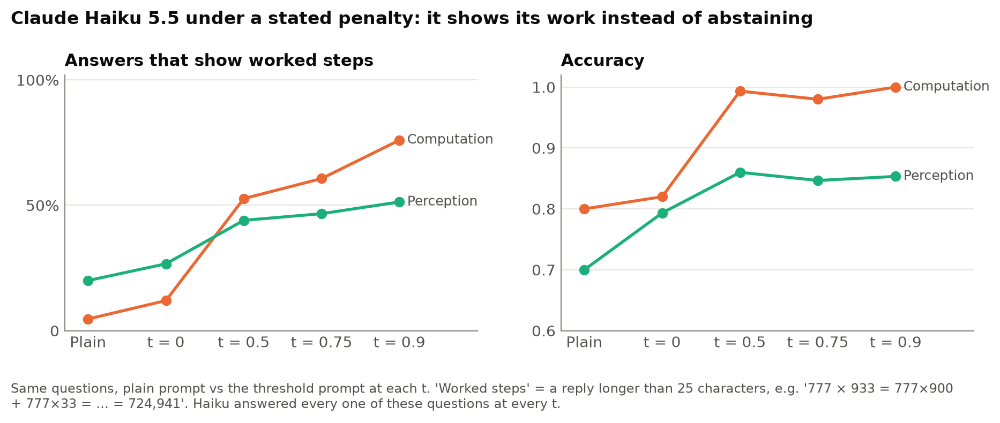

The penalty has a less welcome effect on false premises: models stop correcting them and simply decline. Haiku corrects every false premise in the plain prompt but abstains on 60% of them at t = 0.9, and most Qwen configurations stop correcting premises altogether under the threshold prompt, even at t = 0.

## Forecasting, for completeness

This shows confidence about the world rather than about oneself, so it is kept apart. On 75 market questions that resolved after every model's training cutoff:

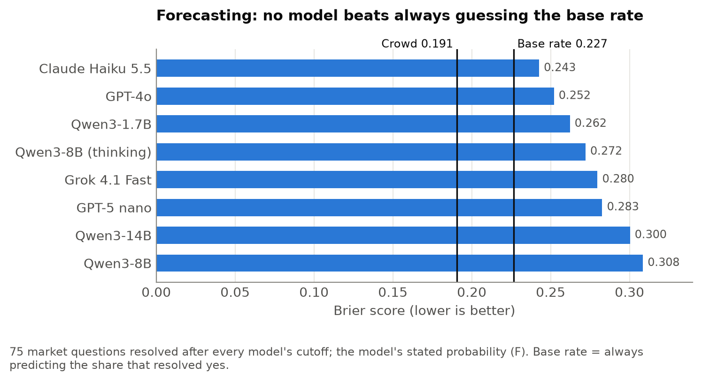

No model beats always guessing the base rate, and the crowd beats them all. The models' forecasts are mostly miscalibrated rather than uninformed, but they are not very informed either.

## What the audit teaches

Four things stand out.

**Self-knowledge is not one skill.** The same model can know which facts it doesn't know, have a rough sense of which sums are hard, and be completely blind to its spelling mistakes. A single calibration number would average these into something meaningless.

**The model's behaviour knows more than its words.** Agreement across a model's own samples and the probability it puts on its answer separate right from wrong far better than anything it says about itself, and the base model, never taught to talk about its confidence, is the best calibrated of all. Whatever instruction tuning does to stated confidence, it mostly teaches models to say "very sure".

**Knowing the stakes isn't the same as acting on them.** Told the cost of being wrong, models notice that there is a cost but not how large it is, and some respond by trying harder rather than by holding back.

**Thinking fixes answers, not self-knowledge.** Reasoning makes a model right far more often, but where it is still wrong, on facts it doesn't hold, it writes the wrong answer with near certainty. The more convincing the answers become, the more it matters that the confidence behind them can be checked.

Which leaves the obvious next question. If sampling reveals self-knowledge that the words hide, is that knowledge already sitting in the model's hidden states before it writes a single token? That's the subject of the next post.
