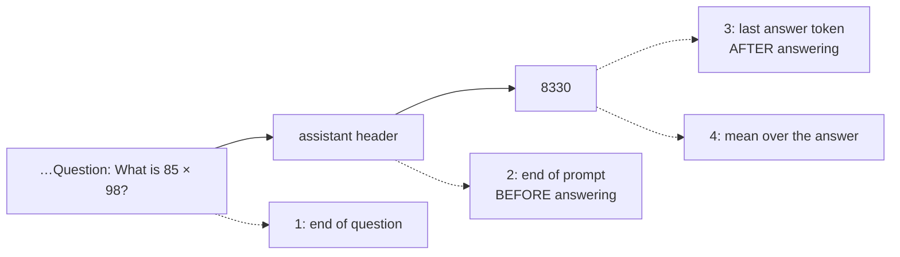
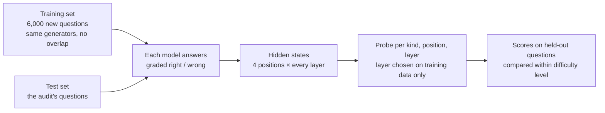
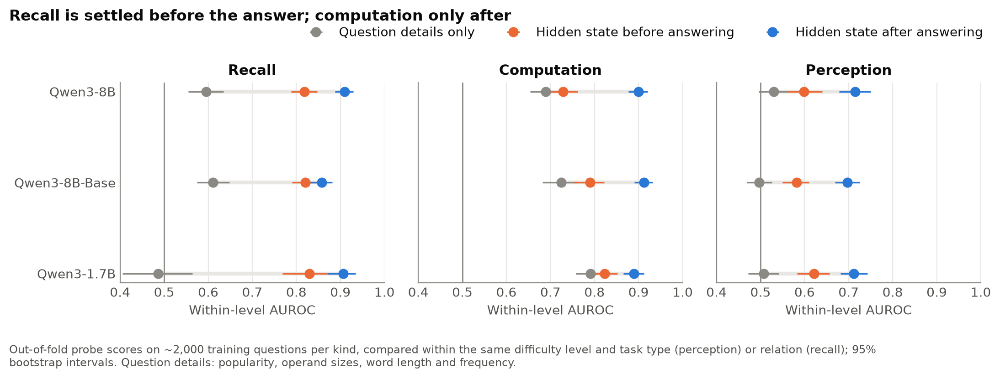
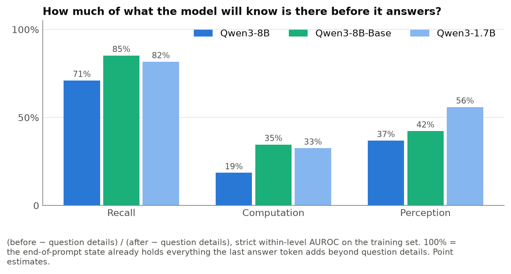
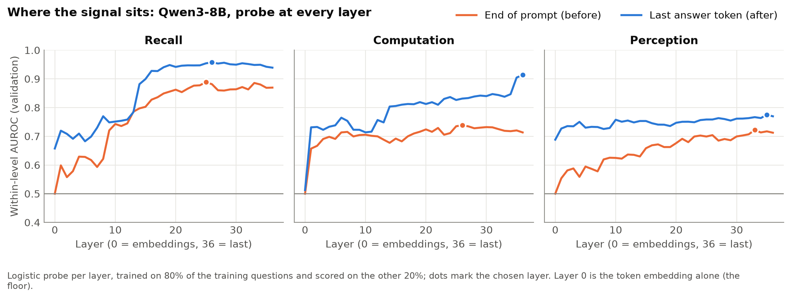
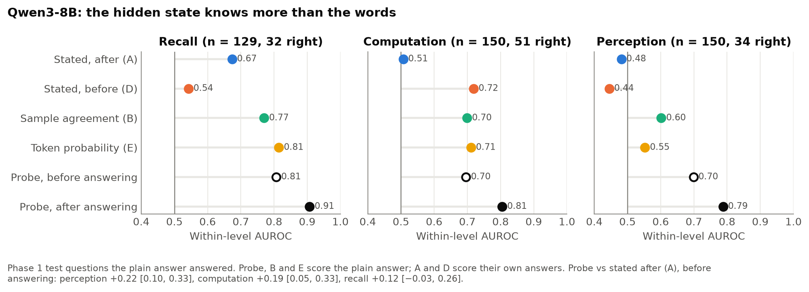
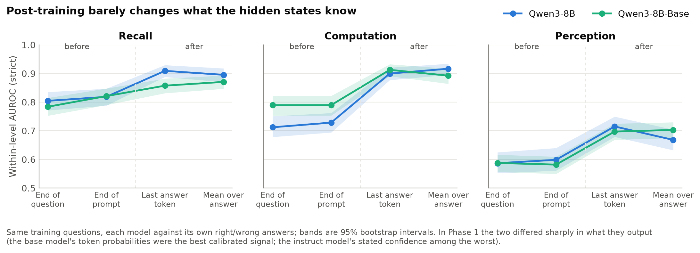
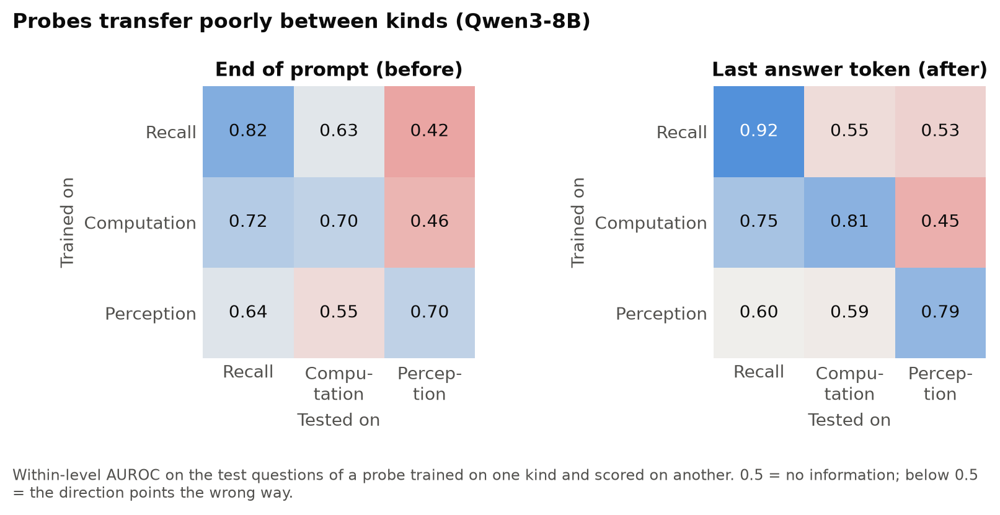

The [confidence audit](2026-11-08-confidence-audit.md) showed us that a model's own samples and token probabilities reveal much more about whether it is right than anything it *says* about its confidence. So is that knowledge already buried inside the model, in its hidden states, before it outputs a single token? This post opens the model up to find out. And the answer depends on what the question involves: **for a factual question, the model knows before it answers whether it will get it right; for a calculation, it only finds out once the answer is written.**{: .rust} And in both cases, the hidden state knows far more than the words that come out.

<!-- more -->

The Confidence Audit framed hallucination as a confidence problem. And reasoning made things worse in one telling way. After reasoning, Qwen3-8B for instance put an average probability of 0.95 on recall answers it got right only a third of the time.

Kalai et al. offer an explanation that the audit could only test from outside. In their account, pre-training leaves a model with a reasonable sense of what it knows, and post-training, rewarded for answering rather than abstaining, teaches it to speak over that sense. If they are right, the uncertainty is still represented somewhere inside the model, and a confident hallucination is a case of the output not reporting what the network intrinsically holds. 

 [Towards Fully Exploiting LLM Internal States to Enhance Knowledge Boundary Perception](https://aclanthology.org/2025.acl-long.1184/) (Ni et al., ACL 2025), shifts perspective from behavioural evaluations (like ConfidenceBench) and theoretical game structures (like Kalai et al.) down to the **mechanistic, hidden representations** inside the model. Instead of asking a model _after_ it talks whether it is confident, or relying on vulnerable verbalised scores, they explore how to read a model’s internal states _before_ and _during_ generation to perceive its true epistemic boundaries.

These are claim about hidden states, so in this experiment we attempt to unravel them.

## Reading a model's mind with a ruler

The tool is a **probe**{: .rust}: a simple classifier trained on a model's internal activations to predict something about the model's behaviour. Here, the something is "will the answer be right?". If a plain linear classifier can read correctness off a layer's activations, the information is there, in a form the rest of the network could easily use.

Where you read matters as much as what you read. A model processes the prompt, then produces its answer token by token, and each position has its own hidden state at every layer. We read four of them:

Position 2 is the key one for "before": it is the state from which the model predicts the first token of its answer, so it holds everything the model has worked out about the question, and nothing about what it is going to say. Position 3 has seen the whole answer. The comparison between them tells us **when**{: .rust} the model's knowledge of its own correctness appears. This follows Ni et al., who found that a probe before generation is almost as good as one after.

## What earlier probes found

Reading self-knowledge from inside a model has a short but busy history:

- **[Language Models (Mostly) Know What They Know](https://arxiv.org/abs/2207.05221)** (Kadavath et al., 2022). Trained models to predict P(IK), the probability that they know the answer to a question, *before* proposing any answer. A predictor trained on trivia separated answerable from unanswerable questions in maths, code and other tasks, but its calibration on those new tasks was weak. Self-knowledge before answering was there, and it didn't transfer cleanly.
- **[The Internal State of an LLM Knows When It's Lying](https://arxiv.org/abs/2304.13734)** (Azaria and Mitchell, Findings of EMNLP 2023). A classifier on hidden activations told true statements from false ones with 71% to 83% accuracy on topics it had not been trained on, where prompting the model to judge them did little better than chance. It was one of the first direct measurements of a model "knowing" more than it says.
- **[LLMs Know More Than They Show](https://arxiv.org/abs/2410.02707)** (Orgad et al., 2024). Found the truthfulness signal concentrated in the tokens of the answer itself, and found that probes do not generalise across tasks, only between tasks that need similar skills. Their conclusion: there is no universal "truthfulness" direction. They also found cases where the model encodes the right answer and still generates a wrong one.
- **[Towards Fully Exploiting LLM Internal States](https://aclanthology.org/2025.acl-long.1184/)** (Ni et al., ACL 2025). The design this post follows. On NQ and HotpotQA, open-ended factual questions, a probe before generation came within a couple of points of one after; on MMLU, the one set needing some reasoning, the gap was larger. They read one middle layer with a small neural network, and used the probe for C3, a method that checks whether the model's confidence holds up when the question is rephrased as multiple choice.
- **[Reasoning Models Know When They're Right](https://arxiv.org/abs/2504.05419)** (Zhang et al., 2025). Probed reasoning models during their chain of thought and found the hidden states predict whether each intermediate answer is correct, with well-calibrated scores, sometimes before that answer is written. Using the probe to stop reasoning early saved 24% of the tokens without losing accuracy. The models encode their correctness but don't use it.

So the signal is known to exist, mostly for facts. Three things are missing, and this post supplies them. First, a test on answers that have to be *computed* or *perceived*, where Ni et al.'s before ≈ after has no reason to hold. Second, a control for difficulty: a probe that merely learns "obscure subjects are hard" or "long multiplications are hard" looks good on most benchmarks without knowing anything about the particular answer. Third, a comparison on the same answers with every confidence method from the audit, and between a base model and its instruction-tuned version, which is the direct test of Kalai's account.

## The setup

Three open models on the RTX 4090, where we can see the hidden states: Qwen3-8B, its base model before instruction tuning, and the smaller Qwen3-1.7B.

The audit's questions are kept as the **test set**{: .rust}, so every probe score sits next to the audit's numbers for the same answers. The probes learn from about 6,000 *new* questions made by the same generators, roughly 2,000 each of facts, multiplications and letter puzzles, each model answering them and each answer graded the same way. Probes are scored the way the audit scored confidence: by within-level AUROC, the chance that a right answer scores higher than a wrong one *of the same difficulty*, so a probe gets no credit for merely knowing that long multiplications are hard.

???+ info "The control that mattered"
    A probe that only sees the question's details (how famous the subject is, how many digits, how long the word, which kind of letter puzzle) already reached 0.7 to 0.8 within a level for some models. Counting letters, finding the nth letter and spelling backwards differ a lot in difficulty, even at the same word length. So every result below is compared against that **question-details probe**{: .rust}, within the same level *and* task type. Whatever the hidden-state probe adds on top of it is knowledge about this particular answer, not about the kind of question.

## Facts are settled before the answer; sums are not

Here is the main result. For each model and kind of question: what the question's details alone predict (grey), what the hidden state predicts before answering (orange) and after (blue).

On **recall**{: .rust}, the orange dot is far to the right of the grey one: before writing anything, the model's state predicts whether it knows the fact, well beyond what the subject's popularity says (+0.22 for Qwen3-8B, +0.34 for the 1.7B). Writing the answer adds a little more.

On **computation**{: .rust}, the orange dot barely leaves the grey one. Before answering, the model's state knows about as much as "bigger numbers are harder" (+0.04 above question details, an interval that touches zero). The jump comes after: +0.17 for Qwen3-8B once the product is written. Whether a multiplication comes out right is decided *during* generation, digit by digit, so the model cannot know it in advance.

Put the two together as a share: of everything the after-answer state knows beyond the question's details, how much was already there before?

Seventy to eighty-five percent for facts; a fifth to just over a third for arithmetic. Perception sits in between. This is the result the audit's categories were built for: **when** a model can know it is wrong depends on how the answer is produced.

## Where in the network

A probe at every layer of Qwen3-8B shows where the signal lives.

Layer 0 is the raw token embedding, the floor: at the end of the prompt it is exactly 0.5, because every prompt ends in the same token. On recall the after-answer signal jumps around layers 13 to 15 and then plateaus; the before-answer signal climbs more slowly, to about layer 20. On computation the after-answer signal keeps climbing to the very last layer, where the state is busy predicting the next token; part of what it reads there may be the model's own sense that its answer is complete.

## The hidden state knows more than the words

Now put the probe next to every method from the audit, on the same test questions, for Qwen3-8B:

The bottom two rows are the probes; the top two are what the model *says*. On perception, where the audit found stated confidence carries no information at all (0.48), the probe reads 0.70 *before the model has answered* and 0.79 after, and after answering it beats sample agreement and token probability too. On computation the probe before answering is level with them and well above the confidence stated after answering (0.51).

**The information is in the model; the words just don't use it.**{: .rust} This is Kalai et al.'s point about hallucination measured directly: the model represents its uncertainty, and the output overrides it. It is also Azaria and Mitchell's and Orgad et al.'s finding, now on questions where the difficulty is held fixed: what the hidden state knows on top of "this is a hard question" is still far more than the words report.

## Post-training changes the words, not the knowledge

In the audit the base model was the best calibrated of all, and the instruct model built from it was among the least informative at stating its confidence. Is that because instruction tuning damaged what the model knows about itself, or only what it says?

The two lines lie on top of each other. After answering, base and instruct models know almost exactly as much about their own correctness; the only gap is before answering on computation, where the base model is slightly ahead. Post-training leaves the knowledge in place and teaches the model to talk over it. This is the second half of Kalai et al.'s account seen from inside: the base model's calibrated probabilities in the audit and the instruct model's uninformative words come from the same internal knowledge, used differently.

## No single "I know this" switch

If there were one direction in the network meaning "I'm on solid ground", a probe trained on facts should work on letter puzzles too. It doesn't:

A probe trained on recall scores 0.42 on perception, slightly *worse* than chance. Arithmetic transfers partly to facts, but not the other way round. Yet a single probe trained on all three kinds at once does almost as well as the three specialised ones, so the directions sit side by side without interfering. The model's self-knowledge is a set of separate signals, one per way of failing, which fits the audit's finding that it can know its gaps in facts while being blind to its spelling. It also matches what Orgad et al. found on other tasks, and Kadavath et al.'s weak calibration on new tasks: self-knowledge travels between questions that need the same skill, and not much further.

???+ warning "What to keep in mind"
    - **After-answer states can see the answer.** A probe there can learn that some answers are more often right (a famous name, a small count). The raw embedding alone reaches up to 0.88 at those positions, so part of the "after" signal is the answer itself. The before-answer results, the key test, have no such issue.
    - **Most comparisons use the training questions.** The audit's 150 questions per kind had too few right answers to separate before from after, so those comparisons use 5-fold cross-validation on the 2,000 training questions per kind, each question scored by a probe that never saw it.
    - **Small open models only**, one prompt, one run. Ni et al.'s nonlinear probe gives the same results as the linear one on average.

## Predictions vs what happened

The predictions were written down before the runs.

| Prediction | Outcome |
| --- | --- |
| Recall: the signal is there before answering, almost as strong as after | Mostly: 0.82 before vs 0.86 to 0.91 after |
| Computation: clearly weaker before than after | **Yes**, and before is barely above the question's details |
| The probe beats stated confidence on every kind | **Yes** |
| The base model's probe beats the instruct model's | No: they're level, which is the more interesting answer |
| Little transfer between kinds | **Yes** |

## What it adds up to

The audit showed that what a model says about its confidence and what its behaviour reveals are different things. Looking inside explains why. The knowledge is there, much of it before the model writes a word, and instruction tuning doesn't remove it; the model simply doesn't report it. And the timing of that knowledge follows the kind of question. A model can know in advance that it doesn't know a fact, because remembering happens in the forward pass; it cannot know in advance that it will slip on a multiplication, because the slip hasn't happened yet.

That suggests where honest confidence will have to come from. Asking a model to state its confidence asks it to read a signal it was never trained to report. Reading the signal directly, or training the model to report it, are both on the table, and the first is just a linear classifier away.

It also suggests where to look next. The audit's thinking model wrote its wrong recall answers with near certainty, and this post probed only models answering without thinking. Zhang et al.'s result says a reasoning model's hidden states track whether each step is right even when the model presses on regardless. If that holds here, the overconfidence of reasoning models is the same story told at greater length: the knowledge of being wrong is in the network, and the chain of thought, like the final answer, doesn't report it. Probing the thinking model step by step, to see when its computation signal appears and whether its confident wrong facts look uncertain from inside, is the natural next experiment.
